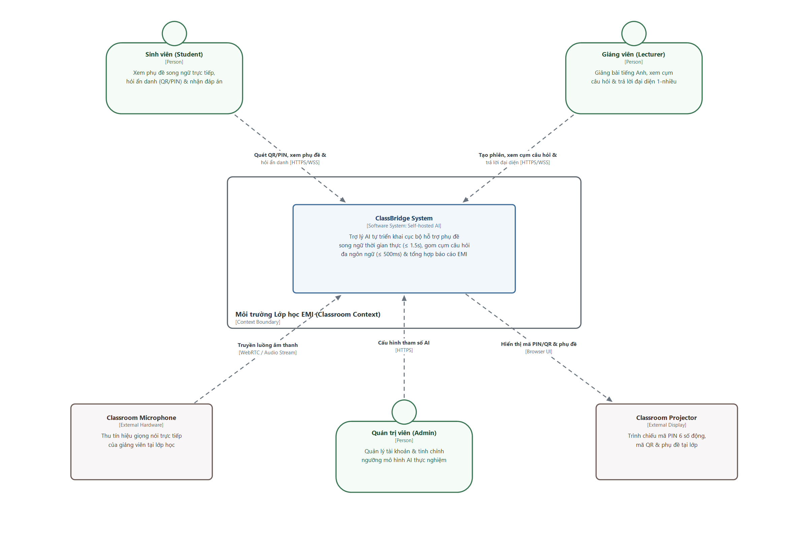
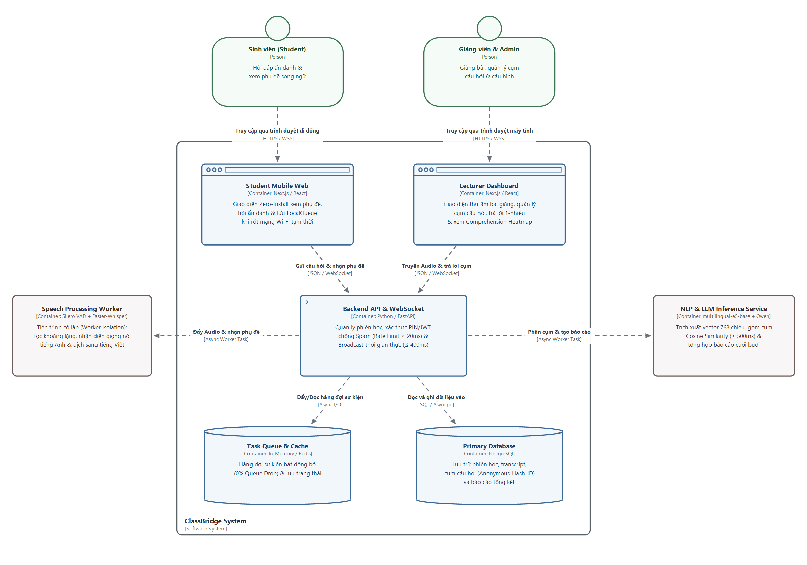
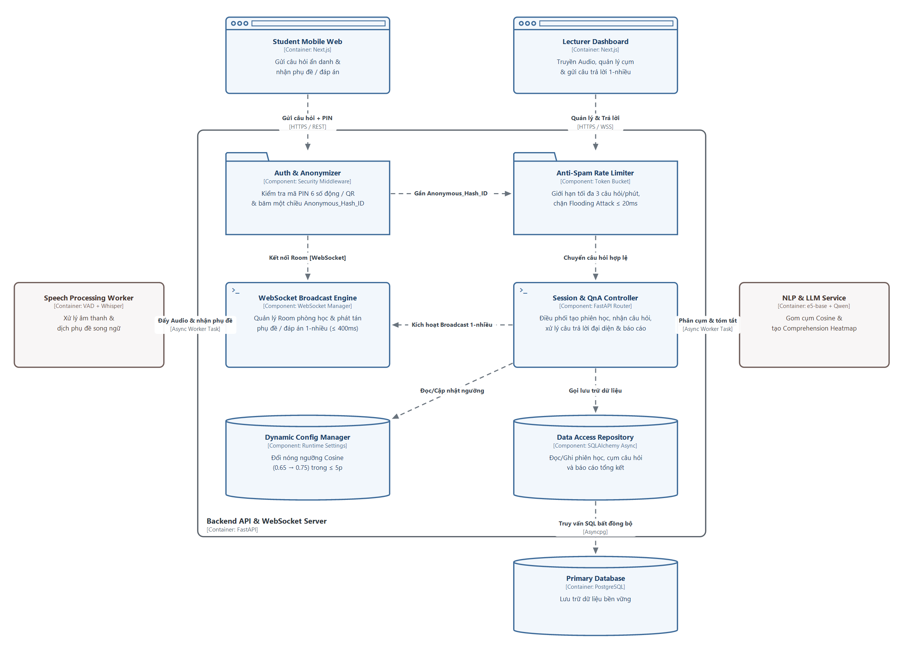
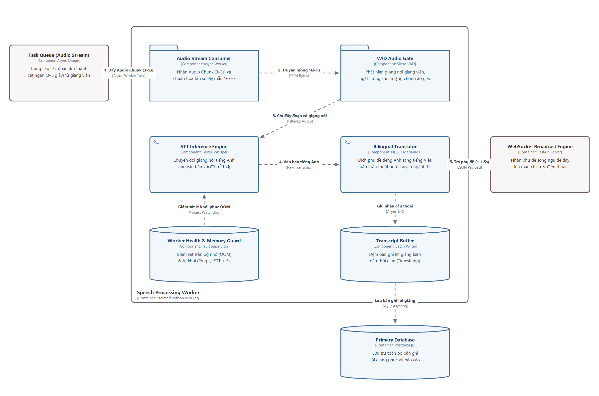
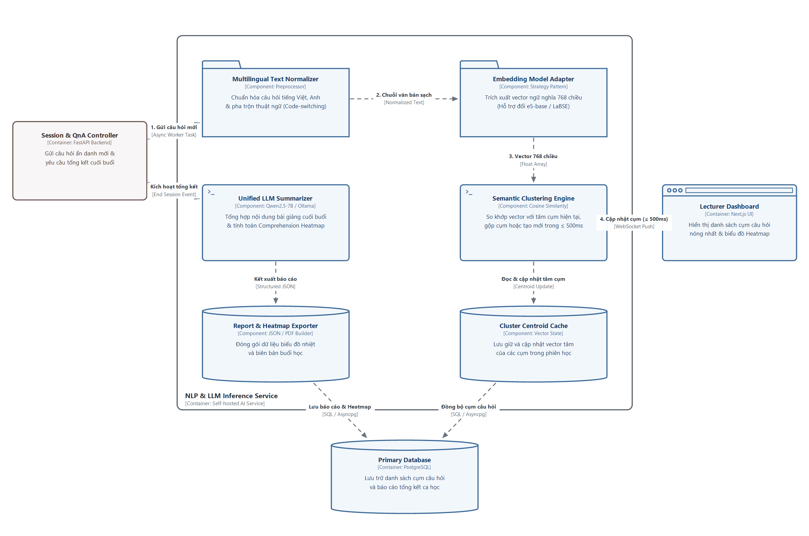
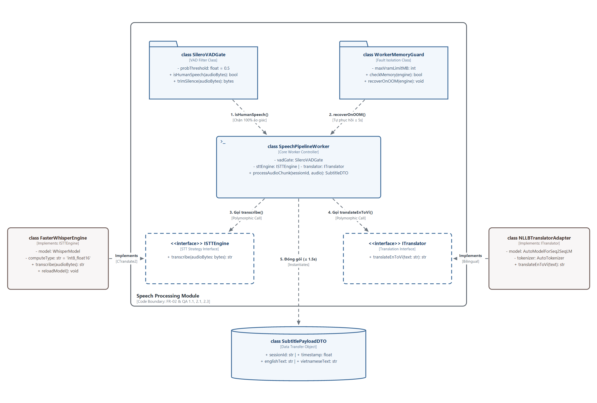
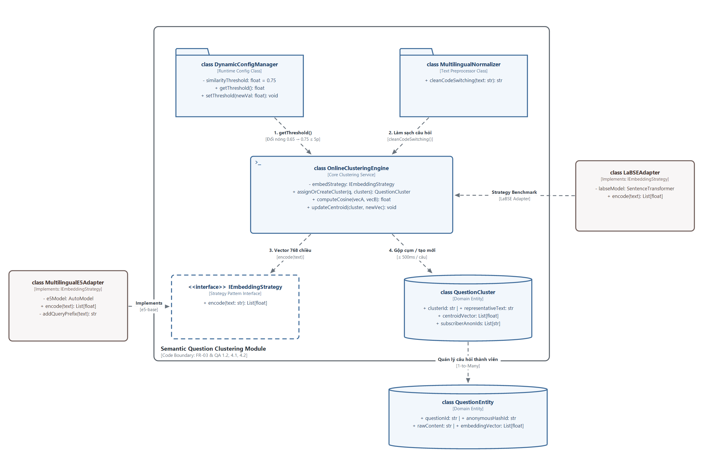
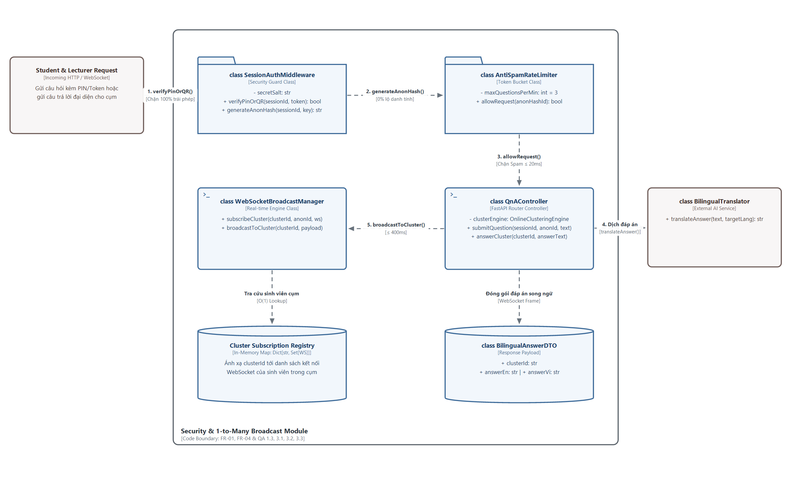
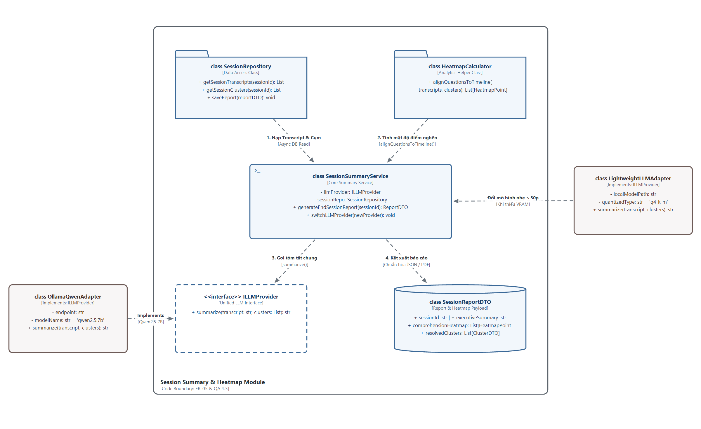

# BÁO CÁO THIẾT KẾ KIẾN TRÚC HỆ THỐNG THEO MÔ HÌNH C4 (C4 MODEL)
**Đề tài:** ClassBridge — AI-Powered Assistant for EMI Classrooms (Hệ thống Trợ lý AI Hỗ trợ Tương tác Lớp học Giảng dạy bằng Tiếng Anh)  
**Mã nhóm:** C1SE.38 — **Đơn vị:** Khoa Kỹ thuật Phần mềm, Đại học Duy Tân (DTU)

---

## CẤP ĐỘ 1: SYSTEM CONTEXT DIAGRAM (1 HÌNH)

### Hình 1: System Context Diagram — Ngữ cảnh Hệ thống ClassBridge
*(Bố cục cân xứng chuẩn C4: Sinh viên & Giảng viên ở 2 bên cánh trên → Hệ thống ClassBridge ở tâm → Thiết bị phòng học & Admin ở dưới)*

#### Mô tả chi tiết Hình 1 (System Context Diagram)
- **Hệ thống trung tâm (ClassBridge System):** Hệ thống trợ lý AI khép kín tự triển khai mô hình mã nguồn mở cục bộ (*Self-hosted / In-house AI Inference*) giúp phá vỡ rào cản ngôn ngữ và khôi phục vòng phản hồi thời gian thực trong lớp học giảng dạy bằng tiếng Anh (EMI) mà không phụ thuộc vào API thương mại bên ngoài.
- **Các Tác nhân (Actors):**
  - **Sinh viên (Student):** Truy cập nhanh vào phiên học qua trình duyệt di động bằng mã QR hoặc mã PIN 6 số với định danh tạm thời (`Anonymous #ID`) mà không cần cài đặt ứng dụng hay đăng nhập. Theo dõi phụ đề song ngữ Anh – Việt trực tiếp, gửi câu hỏi bằng tiếng Việt, tiếng Anh hoặc ngôn ngữ pha trộn (*code-switching*) và nhận câu trả lời từ giảng viên.
  - **Giảng viên (Lecturer):** Khởi tạo phiên học mới, giảng bài trực tiếp bằng tiếng Anh, theo dõi các cụm câu hỏi nóng nhất trên Dashboard và nhập câu trả lời một lần cho câu hỏi đại diện để hệ thống tự động dịch và phát tán (1-nhiều) tới toàn bộ sinh viên trong nhóm đó.
  - **Quản trị viên (Admin):** Quản lý danh sách người dùng, lớp học và điều chỉnh động các tham số thuật toán (như ngưỡng tương đồng *Cosine Similarity Threshold*, đổi mô hình AI) phục vụ thực nghiệm.
- **Các Hệ thống Ngoại vi (External Systems):**
  - **Classroom Microphone:** Hệ thống thu âm tại giảng đường tiếp nhận giọng nói trực tiếp của giảng viên (kèm tạp âm phòng học) để đẩy vào luồng xử lý âm thanh.
  - **Classroom Projector:** Màn chiếu tại lớp hiển thị công khai mã PIN 6 số động (chống người lạ bên ngoài phòng học truy cập trái phép theo Kịch bản QA 3.3) và hiển thị phụ đề song ngữ trực tiếp.

---

## CẤP ĐỘ 2: CONTAINER DIAGRAM (1 HÌNH)

### Hình 2: Container Diagram — Sơ đồ Kiến trúc Container
*(Bố cục chuẩn 100% theo hình mẫu C4: Sinh viên & Giảng viên ở trên, Khung ClassBridge System ở giữa gồm 2 UI ở trên → Backend ở tâm → 2 khối trụ Queue & DB ở đáy → 2 khối AI Worker cô lập ở 2 bên cánh)*

#### Mô tả chi tiết Hình 2 (Container Diagram)
- **Student Mobile Web (Next.js / React):** Ứng dụng web siêu nhẹ chạy trực tiếp trên trình duyệt điện thoại (*Zero-Install*). Tích hợp cơ chế lưu tạm câu hỏi vào *Local Storage Queue* và tự động kết nối lại (*Auto-reconnect*) để đảm bảo 0% mất mát câu hỏi và đồng bộ lại phòng học trong $\le 2\text{s}$ khi mạng Wi-Fi giảng đường bị ngắt quãng (Kịch bản QA 2.2).
- **Lecturer Dashboard (Next.js / React):** Giao diện dành cho giảng viên thu âm giọng giảng, theo dõi các cụm câu hỏi được cập nhật trực tiếp, gửi câu trả lời đại diện 1-nhiều và xem biểu đồ nhiệt điểm nghẽn kiến thức (*Comprehension Heatmap*) cuối buổi.
- **Backend API & WebSocket (Python / FastAPI):** Trái tim điều phối của hệ thống. Quản lý vòng đời phiên học, xác thực mã PIN 6 số động, cấp mã ẩn danh một chiều (`Anonymous_Hash_ID`), chặn đứng tấn công spam vượt ngưỡng 3 câu/phút trong $\le 20\text{ms}$ (Kịch bản QA 3.2) và phát tán câu trả lời 1-nhiều qua WebSocket trong $\le 400\text{ms}$ (Kịch bản QA 1.3).
- **Speech Processing Worker (Silero VAD + Faster-Whisper):** Container độc lập xử lý âm thanh. Được tách rời hoàn toàn (*Worker Isolation*) để nếu tiến trình STT gặp lỗi tràn bộ nhớ (OOM), hệ thống tự động giải phóng bộ nhớ và khởi động lại trong $\le 5\text{s}$ mà không làm gián đoạn luồng Hỏi đáp Q&A (Kịch bản QA 2.1).
- **NLP & LLM Inference Service (multilingual-e5-base + Qwen/Ollama):** Dịch vụ AI trích xuất vector ngữ nghĩa 768 chiều, gom cụm câu hỏi bằng khoảng cách Cosine trong $\le 500\text{ms}$ (Kịch bản QA 1.2) và tổng hợp báo cáo bài giảng cuối buổi (FR-05).
- **Task Queue & Cache (In-Memory / Redis):** Hàng đợi sự kiện trung gian đảm bảo 0% rớt hàng đợi (*0% Queue Drop*) khi 40 sinh viên gửi câu hỏi dồn dập cùng lúc.
- **Primary Database (PostgreSQL):** Lưu trữ bền vững thông tin phiên học, bản ghi lời giảng (*transcript*), các cụm câu hỏi (chỉ lưu `Anonymous_Hash_ID`, cam kết 0% khả năng truy vết ngược danh tính thật theo Kịch bản QA 3.1) và dữ liệu biểu đồ nhiệt cuối buổi.

---

## CẤP ĐỘ 3: COMPONENT DIAGRAM (3 HÌNH RIÊNG BIỆT CHO 3 CONTAINER LÕI)

### Hình 3.1: Component Diagram — Backend API & WebSocket Server
*(Phóng to bên trong Backend API & WebSocket Server với bố cục đối xứng Trái – Giữa – Phải)*

#### Mô tả chi tiết Hình 3.1 (Component Diagram - Backend API & WebSocket Server)
- **Auth & Anonymizer (Security Middleware):** Xác thực mã PIN 6 số động hoặc chữ ký số ngắn hạn trong mã QR để từ chối 100% kết nối trái phép từ bên ngoài lớp học (Kịch bản QA 3.3). Sinh mã định danh băm một chiều `Anonymous_Hash_ID` cho sinh viên, đảm bảo 0% khả năng truy vết ngược danh tính cá nhân (Kịch bản QA 3.1).
- **Anti-Spam Rate Limiter (Token Bucket):** Kiểm soát tần suất gửi câu hỏi theo từng `Anonymous_Hash_ID` (tối đa 3 câu/phút), lập tức từ chối các request vượt ngưỡng trong $\le 20\text{ms}$ trước khi đi vào mô hình AI (Kịch bản QA 3.2).
- **Session & QnA Controller (FastAPI Router):** Xử lý các yêu cầu REST API khởi tạo phiên học, tiếp nhận câu hỏi hợp lệ đẩy sang dịch vụ NLP, nhận câu trả lời đại diện từ giảng viên và kích hoạt tổng hợp báo cáo cuối buổi.
- **WebSocket Broadcast Engine (WebSocket Manager):** Duy trì kết nối WebSocket với 60–100 thiết bị theo cấu trúc Phòng học (*Room*) và Nhóm câu hỏi (*Cluster Group*), đảm bảo phát tán câu trả lời 1-nhiều tới đúng sinh viên trong cụm trong vòng $\le 400\text{ms}$ (Kịch bản QA 1.3).
- **Dynamic Config Manager (Runtime Settings):** Quản lý các tham số động, cho phép nhóm nghiên cứu tinh chỉnh ngưỡng tương đồng ngữ nghĩa (*Similarity Threshold* từ $0.65 \rightarrow 0.75$) ngay giữa các ca học thực nghiệm trong $\le 5$ phút mà không cần biên dịch lại hệ thống (Kịch bản QA 4.2).
- **Data Access Repository (SQLAlchemy Async):** Đóng gói toàn bộ truy vấn đọc/ghi phiên học, lịch sử câu hỏi và báo cáo xuống PostgreSQL.

---

### Hình 3.2: Component Diagram — Speech Processing Worker (Tính năng lõi FR-02)
*(Phóng to bên trong Speech Processing Worker với luồng xử lý cân đối)*

#### Mô tả chi tiết Hình 3.2 (Component Diagram - Speech Processing Worker)
- **Audio Stream Consumer (Async Worker):** Nhận luồng âm thanh cắt theo khung 3–5 giây từ hàng đợi sự kiện và chuẩn hóa về định dạng 16kHz mono.
- **VAD Audio Gate (Silero VAD):** Cổng kiểm soát âm thanh giúp phát hiện khi giảng viên dừng giảng bài (micro chỉ thu tiếng quạt máy và tiếng thảo luận nhỏ) để tự động ngắt luồng đẩy sang Whisper, đảm bảo 0 dòng phụ đề rác/ảo giác (*Hallucination*) và tiết kiệm $\ge 80\%$ tài nguyên GPU/CPU (Kịch bản QA 2.3).
- **STT Inference Engine (Faster-Whisper):** Giải mã các đoạn âm thanh có giọng nói hợp lệ thành văn bản tiếng Anh với tốc độ cao.
- **Bilingual Translator (NLLB / MarianMT):** Dịch văn bản tiếng Anh sang tiếng Việt (bảo toàn thuật ngữ chuyên ngành IT), đảm bảo tổng độ trễ đầu-cuối từ lúc giảng viên ngắt câu đến khi hiển thị phụ đề đạt $\le 1.5\text{s}$ (Kịch bản QA 1.1).
- **Worker Health & Memory Guard & Transcript Buffer:** Thực thi cơ chế cô lập lỗi (*Fault Isolation*); nếu tiến trình STT gặp lỗi tràn bộ nhớ (OOM) hoặc treo do âm thanh nhiễu kéo dài, bộ giám sát tự động giải phóng bộ nhớ và khởi động lại STT Worker trong $\le 5\text{s}$ mà không ảnh hưởng đến luồng Hỏi đáp (Kịch bản QA 2.1), đồng thời lưu bản ghi lời giảng vào PostgreSQL.

---

### Hình 3.3: Component Diagram — NLP & LLM Inference Service (Tính năng lõi FR-03 & FR-05)
*(Phóng to bên trong NLP & LLM Inference Service với bố cục cân đối Trái – Giữa – Phải)*

#### Mô tả chi tiết Hình 3.3 (Component Diagram - NLP & LLM Inference Service)
- **Multilingual Text Normalizer (Preprocessor):** Tiền xử lý văn bản câu hỏi tự do của sinh viên, chuẩn hóa từ viết tắt và cấu trúc pha trộn Việt – Anh (*code-switching*).
- **Embedding Model Adapter (Strategy Pattern):** Chuyển đổi văn bản câu hỏi thành vector ngữ nghĩa 768 chiều. Áp dụng mẫu thiết kế *Strategy/Adapter Pattern* giúp nhóm phát triển dễ dàng thay thế mô hình giữa `LaBSE` và `intfloat/multilingual-e5-base` trong $\le 1$ giờ làm việc để chạy Benchmark đo các chỉ số ARI, NMI, Silhouette Score mà không sửa code phân cụm (Kịch bản QA 4.1).
- **Semantic Clustering Engine (Cosine Similarity):** Tính khoảng cách Cosine giữa vector câu hỏi mới với tâm các cụm hiện tại (*Cluster Centroid Cache*), tự động gộp vào cụm tương đồng hoặc khởi tạo cụm mới và cập nhật lên Dashboard giảng viên trong $\le 500\text{ms}$ với 0% rớt hàng đợi (Kịch bản QA 1.2).
- **Unified LLM Summarizer & Report Exporter:** Sử dụng giao diện LLM chuẩn hóa (*Unified LLM Interface*) gọi mô hình cục bộ (`Qwen2.5-7B` qua Ollama) tổng hợp nội dung bài giảng và tạo dữ liệu *Comprehension Heatmap*, cho phép chuyển đổi sang mô hình gọn nhẹ hơn trong $\le 30$ phút cấu hình khi máy chủ thiếu VRAM (FR-05 & Kịch bản QA 4.3).

---

## CẤP ĐỘ 4: CODE DIAGRAM (4 HÌNH CHO 4 LUỒNG XỬ LÝ LÕI)

### Hình 4.1: Code Diagram — Luồng Phụ đề Song ngữ & VAD Gate Chống ảo giác (FR-02)
*(Bố cục cân xứng: Khung Module ở giữa → Worker Controller ở tâm → 2 Adapter thực thi ở 2 cánh Trái – Phải)*

#### Mô tả chi tiết Hình 4.1 (Code Diagram - Luồng Phụ đề Song ngữ & VAD Gate)
- **Class SpeechPipelineWorker:** Điều phối luồng xử lý âm thanh thông qua phương thức `processAudioChunk(sessionId, audio)`. Luôn kiểm tra âm thanh qua `vadGate.isHumanSpeech(audioBytes)` trước tiên; nếu giảng viên đang im lặng (trả về `False`), phương thức lập tức thoát sớm (*Early Return*) để ngăn chặn 100% lỗi sinh văn bản ảo giác (Kịch bản QA 2.3).
- **Class SileroVADGate:** Chứa phương thức `isHumanSpeech()` tính xác suất có giọng nói con người so với ngưỡng `probThreshold = 0.5` và phương thức `trimSilence()` cắt bỏ khoảng lặng thừa ở hai đầu đoạn âm thanh.
- **Class WorkerMemoryGuard:** Cung cấp phương thức `recoverOnOOM(engine)` bắt ngoại lệ tràn bộ nhớ (*Out-of-Memory*), tự động giải phóng VRAM và gọi `reloadModel()` để khôi phục tiến trình STT trong vòng $\le 5\text{s}$ mà không ảnh hưởng tới luồng Hỏi đáp (Kịch bản QA 2.1).
- **Interface ISTTEngine (FasterWhisperEngine) & ITranslator (NLLBTranslatorAdapter):** Thực hiện nhận diện giọng nói tiếng Anh qua `transcribe()` và dịch sang tiếng Việt qua `translateEnToVi()`, trả về đối tượng `SubtitlePayloadDTO` với tổng độ trễ $\le 1.5\text{s}$ (Kịch bản QA 1.1).

---

### Hình 4.2: Code Diagram — Luồng Gom nhóm Câu hỏi Ngữ nghĩa Đa ngôn ngữ (FR-03 & QA 4)
*(Bố cục cân xứng: Khung Clustering Module ở giữa → 2 Adapter mô hình e5-base và LaBSE ở 2 cánh Trái – Phải)*

#### Mô tả chi tiết Hình 4.2 (Code Diagram - Luồng Gom nhóm Câu hỏi Ngữ nghĩa Đa ngôn ngữ)
- **Class OnlineClusteringEngine:** Chứa thuật toán phân cụm trực tuyến qua phương thức `assignOrCreateCluster(q, clusters)`. Phương thức này gọi `embedStrategy.encode()` để lấy vector 768 chiều, tính khoảng cách qua `computeCosine(vecA, vecB)` và so sánh với ngưỡng lấy từ `DynamicConfigManager`. Nếu độ tương đồng đạt ngưỡng thì gộp câu hỏi vào cụm và gọi `updateCentroid()`; ngược lại thì khởi tạo một `QuestionCluster` mới trong $\le 500\text{ms}$ (Kịch bản QA 1.2).
- **Interface IEmbeddingStrategy, MultilingualE5Adapter, LaBSEAdapter:** Áp dụng mẫu thiết kế *Strategy Pattern* giúp tách rời thuật toán phân cụm khỏi mô hình ngôn ngữ cụ thể. Nhóm nghiên cứu có thể chuyển đổi từ `LaBSE` sang `intfloat/multilingual-e5-base` trong $\le 1$ giờ làm việc để đo chỉ số ARI và Silhouette Score với 0 dòng code bị sửa ở tầng Frontend và Database (Kịch bản QA 4.1).
- **Class DynamicConfigManager:** Cung cấp phương thức `setThreshold(newVal)` cho phép cập nhật nóng ngưỡng tương đồng (ví dụ từ $0.65$ lên $0.75$) ngay giữa các ca học thực nghiệm trong $\le 5$ phút (Kịch bản QA 4.2).
- **Class QuestionCluster & QuestionEntity:** Lưu trữ câu hỏi đại diện (`representativeText`), vector tâm cụm (`centroidVector`) và danh sách định danh ẩn danh của sinh viên trong cụm (`subscriberAnonIds`) để phục vụ phản hồi 1-nhiều.

---

### Hình 4.3: Code Diagram — Luồng Bảo mật Ẩn danh, Chống Spam & Phản hồi 1-nhiều (FR-01, FR-04 & QA 3)
*(Bố cục cân xứng: Khung Security & Broadcast ở giữa → Request đầu vào bên trái, Dịch vụ dịch thuật bên phải)*

#### Mô tả chi tiết Hình 4.3 (Code Diagram - Luồng Bảo mật Ẩn danh, Chống Spam & Phản hồi 1-nhiều)
- **Class SessionAuthMiddleware:** Phương thức `verifyPinOrQR(sessionId, token)` kiểm tra mã PIN 6 số động hoặc chữ ký số ngắn hạn trong mã QR để từ chối 100% kết nối không hợp lệ (Kịch bản QA 3.3). Phương thức `generateAnonHash()` tạo mã băm một chiều `Anonymous_Hash_ID`, cam kết không lưu họ tên, MSSV, email hay IP cá nhân (Kịch bản QA 3.1).
- **Class AntiSpamRateLimiter:** Phương thức `allowRequest(anonHashId)` giới hạn tối đa 3 câu hỏi/phút trên mỗi phiên ẩn danh, chặn đứng các cuộc tấn công spam trong $\le 20\text{ms}$ (Kịch bản QA 3.2).
- **Class QnAController & WebSocketBroadcastManager:** Khi sinh viên gửi câu hỏi qua `submitQuestion()`, kết nối WebSocket được đăng ký vào `Cluster Subscription Registry` qua hàm `subscribeCluster()`. Khi giảng viên trả lời câu hỏi đại diện qua `answerCluster()`, hệ thống dịch song ngữ câu trả lời và gọi `broadcastToCluster()` để đẩy thông báo đồng thời đến 100% sinh viên trong cụm đó trong vòng $\le 400\text{ms}$ (Kịch bản QA 1.3).

---

### Hình 4.4: Code Diagram — Luồng Tổng hợp Báo cáo & Heatmap Cuối buổi (FR-05 & QA 4.3)
*(Bố cục cân xứng: Khung Summary Module ở giữa → 2 Adapter LLM Qwen2.5-7B và LightweightLLM ở 2 cánh Trái – Phải)*

#### Mô tả chi tiết Hình 4.4 (Code Diagram - Luồng Tổng hợp Báo cáo & Heatmap Cuối buổi)
- **Class SessionSummaryService & HeatmapCalculator:** Khi kết thúc buổi học, phương thức `generateEndSessionReport(sessionId)` truy xuất toàn bộ bản ghi lời giảng (*transcript*) và danh sách các cụm câu hỏi từ `SessionRepository`. Đồng thời, phương thức `alignQuestionsToTimeline()` đối chiếu mật độ câu hỏi của sinh viên theo dòng thời gian bài giảng để tạo dữ liệu biểu đồ nhiệt *Comprehension Heatmap* (FR-05).
- **Interface ILLMProvider, OllamaQwenAdapter, LightweightLLMAdapter:** Chuẩn hóa tầng giao tiếp mô hình ngôn ngữ lớn qua một giao diện thống nhất (*Unified LLM Interface*). Khi triển khai tại phòng học mới có máy chủ cục bộ thiếu VRAM, nhóm phát triển có thể chuyển đổi từ `OllamaQwenAdapter` (`Qwen2.5-7B`) sang `LightweightLLMAdapter` trong $\le 30$ phút cấu hình mà vẫn giữ nguyên định dạng `SessionReportDTO` phục vụ hiển thị biểu đồ nhiệt và xuất file PDF lưu trữ (Kịch bản QA 4.3).

