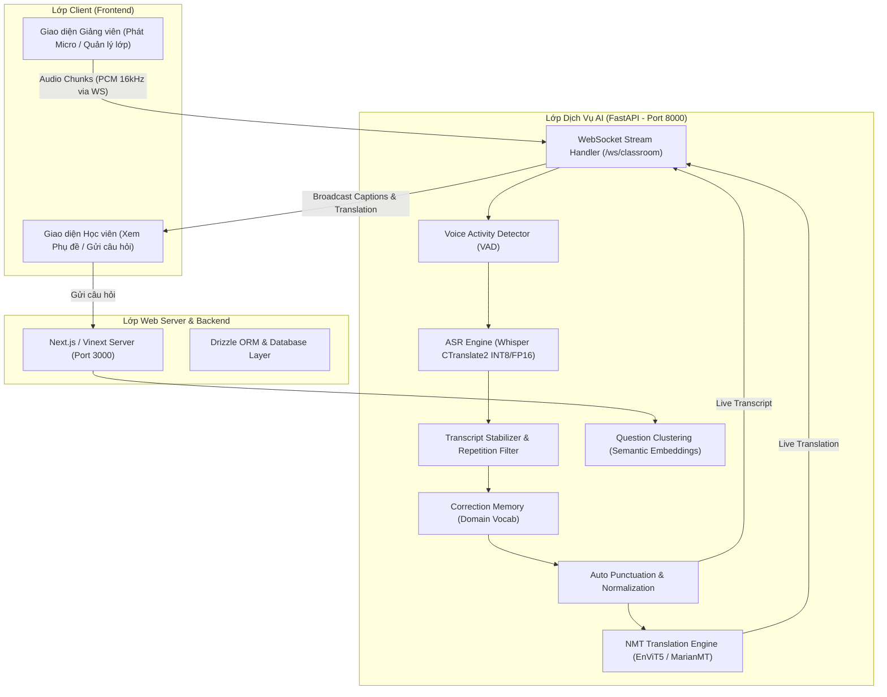

# 01. Tổng Quan & Kiến Trúc Hệ Thống (System Overview & Architecture)

---

## 1. Giới Thiệu Dự Án ClassBridge

**ClassBridge** là giải pháp trợ giảng lớp học thông minh sử dụng Trí tuệ nhân tạo (AI) để hỗ trợ quá trình giảng dạy và học tập song ngữ (Anh – Việt). Hệ thống giải quyết các thách thức lớn trong giảng dạy đại học và hội thảo quốc tế:
- **Rào cản ngôn ngữ**: Giảng viên giảng bằng tiếng Anh hoặc tiếng Việt xen lẫn thuật ngữ chuyên ngành; sinh viên cần phụ đề dịch trực tiếp tức thời.
- **Hiện tượng Code-switching & Đa phương ngữ**: Giảng viên người Việt nói tiếng Anh hoặc phát âm tiếng Việt đa vùng miền (Bắc, Trung, Nam), nói xen kẽ thuật ngữ kỹ thuật (IT/AI).
- **Độ trễ thấp trong thời gian thực**: Yêu cầu phụ đề và bản dịch xuất hiện trên màn hình người học với độ trễ siêu thấp (< 100ms - 300ms) để không ngắt quãng trải nghiệm nghe nhìn.
- **Tổng hợp & Quản lý câu hỏi thông minh**: Tự động gom cụm các câu hỏi trùng lặp hoặc cùng chủ đề của sinh viên để giảng viên dễ dàng giải đáp.

---

## 2. Kiến Trúc Tổng Thể Hệ Thống (System Architecture)

Hệ thống được thiết kế theo kiến trúc vi dịch vụ (Microservices-oriented) phân tách rõ ràng giữa giao diện người dùng, backend quản lý lớp học và AI engine chuyên sâu:

---

## 3. Các Phân Hệ Cốt Lõi

### 3.1. Frontend Web Client (`classbridge/frontend`)
- **Công nghệ**: React 19, Next.js 16 (chạy tối ưu hóa trên nền Vinext / Vite), TailwindCSS 4, TypeScript.
- **Tính năng**:
  - Giao diện giáo viên: Bật/tắt micro, hiển thị sóng âm thanh, cấu hình ngôn ngữ nguồn/đích, tạo mã tham gia lớp học (`join_code`).
  - Giao diện sinh viên: Nhập mã phòng để xem phụ đề song ngữ thời gian thực trên mọi thiết bị (Laptop, Máy tính bảng, Điện thoại), gửi câu hỏi bài giảng.
  - Màn hình hiển thị cụm câu hỏi thông minh theo chủ đề (Questions Clustering Dashboard).

### 3.2. AI Engine Service (`classbridge/backend/ai-service`)
- **Công nghệ**: Python 3.11+, FastAPI, Uvicorn, CTranslate2, Hugging Face Transformers, PyTorch CUDA.
- **Nhiệm vụ**:
  - Tiếp nhận luồng âm thanh PCM16 qua kết nối WebSocket hai chiều.
  - Phân tích giọng nói và giải mã phụ đề tức thời (Rolling Window ASR).
  - Tự động phát hiện và dịch thuật song ngữ (Anh ⇄ Việt).
  - Chống giật, làm mượt phụ đề và áp dụng bộ nhớ sửa lỗi tự động.

### 3.3. Training & Optimization Suite (`classbridge/training`)
- Bộ công cụ hoàn chỉnh để thu thập dữ liệu âm thanh, huấn luyện LoRA cho Whisper và NMT, xuất mô hình sang định dạng CTranslate2 INT8 phục vụ môi trường Production.

---

## 4. Luồng Dữ Liệu Thời Gian Thực (Real-Time Dataflow)

1. **Thu âm & Streaming**: Micro từ trình duyệt giảng viên thu thập âm thanh ở định dạng PCM 16-bit Mono, tần số 16kHz, đóng gói thành các đoạn (chunk) 200ms - 500ms và gửi qua WebSocket.
2. **Tiếp nhận & Lọc nhiễu**: AI Service nhận chunk, đưa qua bộ đệm rolling buffer (8 giây) và kiểm tra hoạt động âm thanh (VAD).
3. **Nhận dạng nhanh (Partial ASR)**: Mô hình Whisper CTranslate2 với chế độ Greedy/Beam-1 tạo ra phụ đề thô (partial transcript) sau mỗi 0.3s.
4. **Hậu xử lý & Làm mượt**:
   - `TranscriptStabilizer` kiểm tra phần text cố định (frozen prefix) và phần text đang thay đổi.
   - `CorrectionMemory` thay thế các từ ngữ kỹ thuật/chuyên ngành bị phát âm lệch.
   - `AutoPunctuation` tự động viết hoa và đặt dấu chấm, dấu phẩy.
5. **Dịch thuật song ngữ (NMT)**: Luồng câu hoàn chỉnh được chuyển tới mô hình dịch máy để sinh bản dịch tương ứng.
6. **Phát sóng (Broadcast)**: Máy chủ WebSocket broadcast đồng thời bản ghi lời (transcript) và bản dịch (translation) đến tất cả sinh viên đang theo dõi phòng học.
