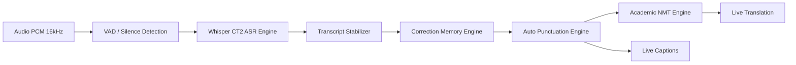

# 02. Kiến Trúc AI & Pipeline Xử Lý (AI Pipeline & Models)

---

## 1. Tổng Quan Pipeline AI

Pipeline AI của ClassBridge là một hệ thống xử lý đa tầng (Multi-stage Pipeline) kết hợp giữa các mô hình học sâu (Deep Learning Models) và các thuật toán tiền/hậu xử lý luồng dữ liệu thời gian thực:

---

## 2. Các Module AI Chi Tiết

### 2.1. Module Nhận Dạng Giọng Nói (ASR - Automatic Speech Recognition)

- **Mô hình nền tảng**: OpenAI Whisper (Small / Large-v3-Turbo).
- **Tối ưu hóa Engine**: **CTranslate2** với kỹ thuật lượng tử hóa (Quantization) `INT8_FLOAT16` hoặc `INT8`.
  - Giảm dung lượng VRAM từ 6GB-10GB xuống < 2GB.
  - Tăng tốc độ suy luận (Inference speed) gấp 4x - 8x so với PyTorch tiêu chuẩn.
- **Cơ chế Decoder-Only LoRA Fine-Tuning**:
  - Khi fine-tune cho tiếng Việt và tiếng Anh giọng địa phương, kỹ thuật LoRA (Low-Rank Adaptation) chỉ được áp dụng vào các tầng self-attention và cross-attention của Decoder (`q_proj`, `v_proj`).
  - Encoder và module Language Identification được giữ cố định (Frozen). Điều này ngăn chặn triệt để hiện tượng *Catastrophic Forgetting* (quên ngôn ngữ gốc hoặc nhận diện sai mã ngôn ngữ).
- **Cơ chế Dual-Specialist Decoding**:
  - *Primary Model (`whisper-decoder-micro1-ct2`)*: Chuyên trách phát hiện ngôn ngữ và giải mã tiếng Việt (Đạt WER tiếng Việt ~25.40%).
  - *Secondary Specialist (`whisper-decoder-micro4-en-ct2`)*: Chuyên trách giải mã câu tiếng Anh học thuật (Đạt WER tiếng Anh ~6.80%).

---

### 2.2. Module Dịch Thuật Học Thuật (Academic NMT - Neural Machine Translation)

- **Kiến trúc**: Sử dụng các mô hình Transformer dịch thuật tiên tiến (EnViT5, MarianMT hoặc biến thể Seq2Seq) được tinh chỉnh qua LoRA.
- **Đặc tính hỗ trợ 2 chiều**:
  - Tiếng Anh → Tiếng Việt: Dịch bài giảng từ giáo trình quốc tế sang tiếng Việt chuẩn sư phạm.
  - Tiếng Việt → Tiếng Anh: Hỗ trợ giảng viên người Việt thuyết trình cho sinh viên quốc tế.
- **Tối ưu từ vựng chuyên ngành (Domain Adaptation)**:
  - Tích hợp kho ngữ liệu từ vựng CNTT, Khoa học dữ liệu, Trí tuệ nhân tạo và thuật ngữ học vụ (DTU Academic Vocabulary).

---

### 2.3. Module Ổn Định Dòng Văn Bản (Transcript Stabilizer)

Khi nhận dạng giọng nói theo thời gian thực (Streaming ASR), mô hình liên tục giải mã cửa sổ âm thanh cuốn chiếu (Rolling Window 8s). Nếu không có bộ ổn định, phụ đề hiển thị sẽ bị giật và thay đổi liên tục:

- **Thuật toán Tiền tố Cố định (Stable Prefix Extraction)**: Phân tách câu thành 2 phần:
  1. *Phần cố định (Frozen/Committed text)*: Đoạn văn bản có độ tin cậy cao, không bị sửa lại.
  2. *Phần biến động (Volatile tail)*: Các từ cuối cùng đang được nói và cập nhật liên tục.
- **Khử lặp từ & câu (Repetition Removal)**: Loại bỏ triệt để các token lặp lại do hiện tượng nhiễu âm micro hoặc giọng ậm ừ ("ờ, à", "uhm, ah").

---

### 2.4. Module Tự Động Thêm Dấu Câu (Auto Punctuation & Normalization)

- Tự động phát hiện ranh giới câu dựa trên khoảng lặng (silence duration) và ngữ pháp.
- Viết hoa đầu câu, viết hoa tên riêng, viết hoa chữ cái đầu của các danh từ chuyên ngành.
- Thêm dấu chấm (`.`), dấu phẩy (`,`), dấu hỏi chấm (`?`) phù hợp theo ngữ điệu.

---

### 2.5. Module Bộ Nhớ Sửa Lỗi (Correction Memory Engine)

- Được định nghĩa tại `correction_memory.py` và lưu trữ tại `correction-memory.json`.
- Cho phép định nghĩa bảng tra cứu quy tắc sửa lỗi tự động theo ngữ cảnh bài học.
- **Ví dụ**:
  - Khi giảng viên phát âm *"bai-thần"* hoặc *"pai-thon"* → Tự động sửa thành **`Python`**.
  - Khi phát âm *"cu-bơ-net"* → Tự động sửa thành **`Kubernetes`**.
  - Khi phát âm *"n-m-t"* → Tự động chuẩn hóa thành **`NMT`**.

---

### 2.6. Module Phân Tích & Gom Nhóm Câu Hỏi (Question Clustering)

- Được xây dựng tại `question_clustering.py`.
- **Cơ chế hoạt động**:
  1. **Trích xuất đặc trưng (Text Embeddings)**: Chuyển đổi nội dung câu hỏi của sinh viên thành vector ngữ nghĩa.
  2. **Gom cụm mật độ (Clustering Algorithm)**: Áp dụng thuật toán gom cụm (như Agglomerative Clustering / HDBSCAN / Cosine Similarity Threshold) để nhóm các câu hỏi có nội dung tương đồng.
  3. **Trích xuất từ khóa chủ đề (Topic / Keyword Extraction)**: Tự động gắn nhãn chủ đề đại diện cho mỗi cụm câu hỏi.
  4. **Thống kê mức độ quan tâm**: Đếm số lượng sinh viên có cùng thắc mắc để ưu tiên cho giảng viên giải đáp.
