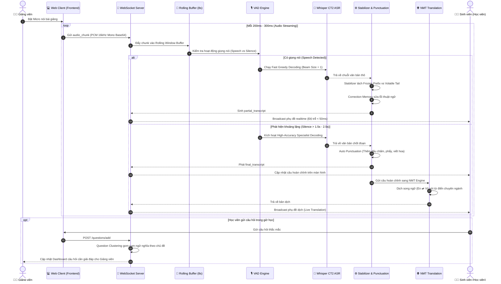
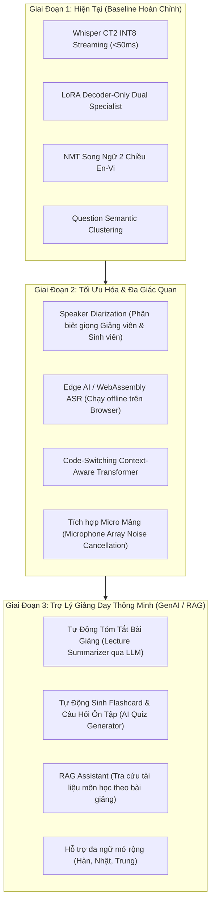

# 06. Luồng Xử Lý Chi Tiết & Hướng Phát Triển Hệ Thống (Workflow & Technical Roadmap)

---

## 1. Sơ Đồ Luồng Xử Lý Chi Tiết (End-to-End Processing Workflow)

Tài liệu này mô tả chi tiết từng bước xử lý dữ liệu từ thời điểm âm thanh được thu từ micro cho đến khi hiển thị phụ đề song ngữ và phân tích bài giảng trên màn hình người học.

---

## 2. Phân Tích Logic Luồng Dữ Liệu Từng Tầng

### 2.1. Tầng Thu Âm & Bộ Đệm Cuốn Chiếu (Audio Streaming & Rolling Buffer)
- **Chuẩn hóa đầu vào**: Âm thanh từ `navigator.mediaDevices.getUserMedia` được chuyển đổi sang chuẩn **16kHz, 16-bit Mono PCM**.
- **Cửa sổ trượt 8 giây (`STREAM_ROLLING_SECONDS = 8`)**:
  - Không xử lý từng đoạn rời rạc để tránh mất ngữ cảnh âm học.
  - Luôn giữ 8 giây âm thanh gần nhất; mỗi khi có chunk mới (300ms), cửa sổ trượt tịnh tiến về phía trước.

### 2.2. Tầng Nhận Dạng 2 Giai Đoạn (Two-Tier ASR Pipeline)
1. **Giai đoạn 1 - Nhận dạng nhanh (Fast Streaming Partial)**:
   - Sử dụng `Beam Size = 1`, giải mã tham lam (Greedy).
   - Mục đích: Đạt tốc độ hiển thị tức thì, tạo cảm giác phản hồi theo từng từ người nói phát ra.
2. **Giai đoạn 2 - Giải mã chuẩn xác khi kết thúc câu (Accurate Finalizer)**:
   - Khi phát hiện người nói ngắt nghỉ (`STREAM_FINAL_SILENCE_SECONDS = 2.5s`), kích hoạt Specialist Model (`whisper-decoder-micro1` cho tiếng Việt hoặc `micro4` cho tiếng Anh).
   - Sử dụng `Beam Size = 2`, áp dụng Temperature Fallback nếu độ tự tin thấp (`WHISPER_RETRY_CONFIDENCE = 0.38`).

### 2.3. Tầng Hậu Xử Lý & Dịch Thuật Đồng Bộ (Post-Processing & NMT)
- **Chống rung lắc phụ đề (Flicker Reduction)**: Giữ nguyên các từ đã được xác nhận ở các vòng trước (`frozen_prefix`), chỉ cập nhật phần đuôi câu (`volatile_suffix`).
- **Khử lặp âm do Micro (`remove_repetitions`)**: Loại bỏ các chuỗi lặp vô nghĩa (ví dụ: *"học học học phần"* $\rightarrow$ *"học phần"*).
- **Hàng đợi Dịch thuật bất đồng bộ (Async NMT Queue)**: Dịch thuật NMT không chặn (non-blocking) luồng ASR, đảm bảo phụ đề gốc luôn chạy mượt mà ngay cả khi mô hình dịch đang xử lý câu dài.

---

## 3. Định Hướng Phát Triển & Mở Rộng Nghiên Cứu (Future Roadmap & Research Directions)

Phục vụ đề tài Nghiên cứu Khoa học (NCKH) và nâng cấp hệ thống trong các giai đoạn tiếp theo:

---

### 3.1. Hướng Nghiên Cứu 1: Phân Tách Giọng Nói Đa Người (Speaker Diarization)
- **Mục tiêu**: Khi sinh viên trong lớp phát biểu hoặc đặt câu hỏi, hệ thống tự động nhận diện và gán nhãn đúng người nói (ví dụ: `[Giảng viên]: ...`, `[Sinh viên A]: ...`).
- **Phương pháp**: Ứng dụng mô hình trích xuất vector đặc trưng giọng nói (Speaker Embedding như PyAnnote Audio / ECAPA-TDNN) kết hợp thuật toán phân cụm trực tuyến (Online Clustering).

### 3.2. Hướng Nghiên Cứu 2: Nâng Cao Khả Năng Xử Lý Pha Trộn Ngôn Ngữ (Advanced Code-Switching)
- **Mục tiêu**: Nâng cao độ chính xác khi giảng viên nói tiếng Việt chêm xen kẽ thuật ngữ kỹ thuật tiếng Anh phức tạp (ví dụ: *"Khi compile đoạn code này, framework sẽ trigger một asynchronous event"*).
- **Phương pháp**: Huấn luyện Language Model ngữ cảnh kết hợp bảng âm vị học IPA đối chiếu giữa tiếng Anh và cách người Việt phát âm từ mượn.

### 3.3. Hướng Nghiên Cứu 3: Tích Hợp Mô Hình Ngôn Ngữ Lớn & RAG (Lecture LLM & RAG)
- **Tóm tắt bài học tự động (Auto-Summarization)**: Cuối mỗi buổi học, hệ thống tự động tổng hợp toàn bộ transcript thành bản tóm tắt các ý chính (Key Takeaways).
- **Sinh bài tập ôn luyện (Smart Quiz Generator)**: Tự động trích xuất các khái niệm trọng tâm trong bài giảng để tạo 5-10 câu hỏi trắc nghiệm ôn tập cho sinh viên.
- **Trợ lý giải đáp học tập RAG**: Cho phép sinh viên đặt câu hỏi dựa trên nội dung slide bài giảng và transcript buổi học.

### 3.4. Hướng Nghiên Cứu 4: Tối Ưu Hóa Biên (On-Device / Edge ASR)
- Biên dịch mô hình Whisper sang định dạng **ONNX Runtime Web / WebAssembly (WASM)** hỗ trợ WebGPU để chạy trực tiếp trên trình duyệt của người dùng mà không cần gửi dữ liệu âm thanh về máy chủ trung tâm, giúp bảo mật tối đa và giảm 100% tải GPU máy chủ.
